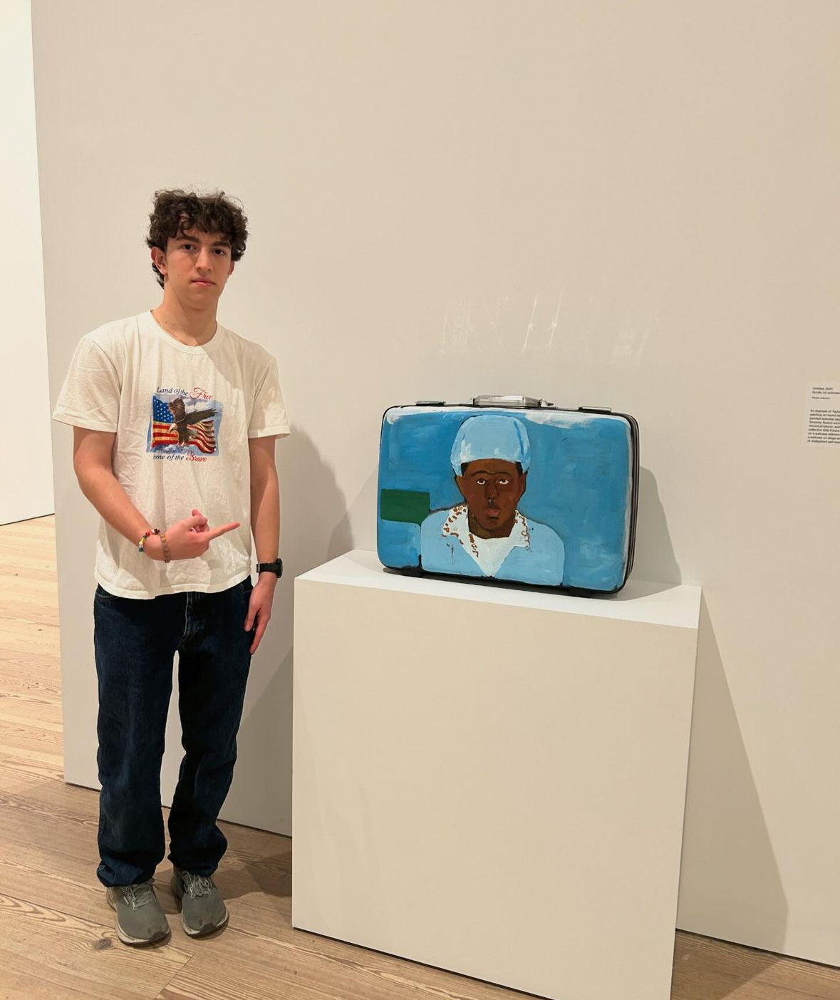
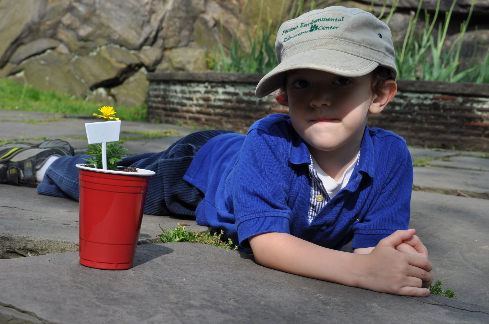

<div class="home-cover">

I'm an undergrad senior studying computer science at Cornell, interested in programming language theory and formal verification. Some areas I find especially exciting:

- Category theory and HoTT: I like to browse [nLab](https://ncatlab.org) and the [HoTT book](https://homotopytypetheory.org/book/) (when I can).

- Coalgebra: automata as coalgebras and using coinduction to reason about infinite behavior.

- Probabilistic programming: [*Foundations of Probabilistic Programming*](https://doi.org/10.1017/9781108770750) is next on my reading list.

Outside of CS, I enjoy playing bass guitar, skateboarding, reading, and watching New York sports.
</div>

<div class="home-cover">

> I care a lot about biodiversity and environmental justice; in high school I volunteered as a gardener at [Wave Hill](https://www.wavehill.org), a lovely botanical garden in the Bronx. I think a lot about the environmental impact of AI compute and data centers. Whatever we build should be worth what it costs the world.
</div>


::: {.home-photo-controls}

```{=html}
<div class="homepage-photo-frame">
  
</div>
```



```{=html}
<div class="young-modi-photo-frame">
  
</div>
```


:::
