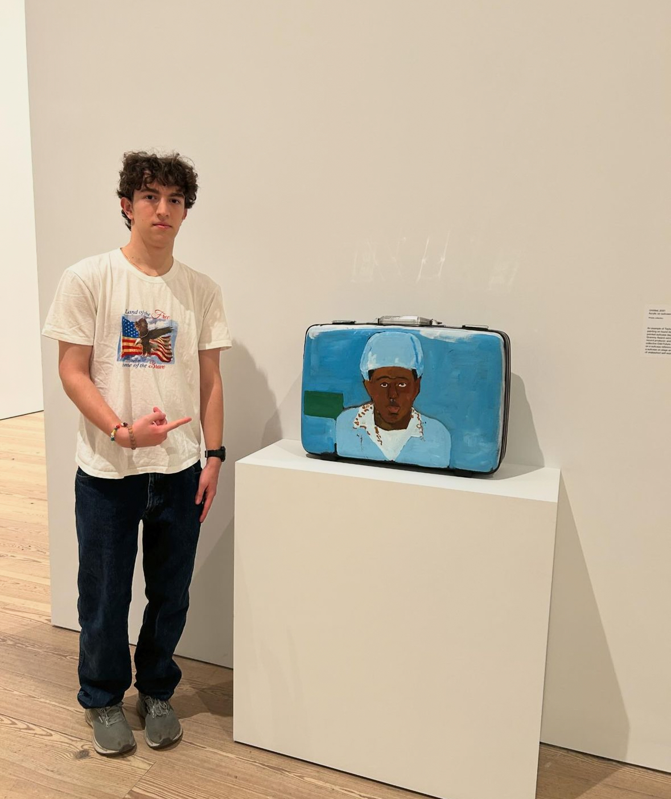
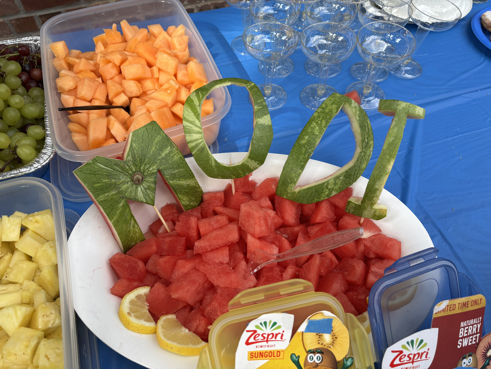

<div class="home-cover">

I'm an undergrad senior studying computer science at Cornell. My research interests are in theoretical computer science, especially logic and programming languages.

Outside of CS, I enjoy playing bass guitar, skateboarding, playing [Bethesda games](https://bethesda.net/en/games), and watching New York sports.

Some other stuff I'm up to right now:

- **Teaching:** Head TA for [CS 3110](https://cs3110.github.io/textbook/cover.html) and TA for [EAS 1540](https://classes.cornell.edu/browse/roster/FA26/class/EAS/1540).
- **Research:** Working with [Dexter Kozen](https://www.cs.cornell.edu/~kozen/) on a guarded version of [probabilistic multiset semantics](https://arxiv.org/abs/2412.06754), and (occasionally) contributing to [raig](https://github.com/cucapra/raig) with the [Capra](https://capra.cs.cornell.edu/) research group.

Feel free to email me at [mbg237@cornell.edu](mailto:mbg237@cornell.edu)!

</div>

::: {.home-photo-controls}

```{=html}
<div class="homepage-photo-frame">
  
</div>
```



```{=html}
<div class="watermelon-photo-frame">
  
</div>
```


:::
